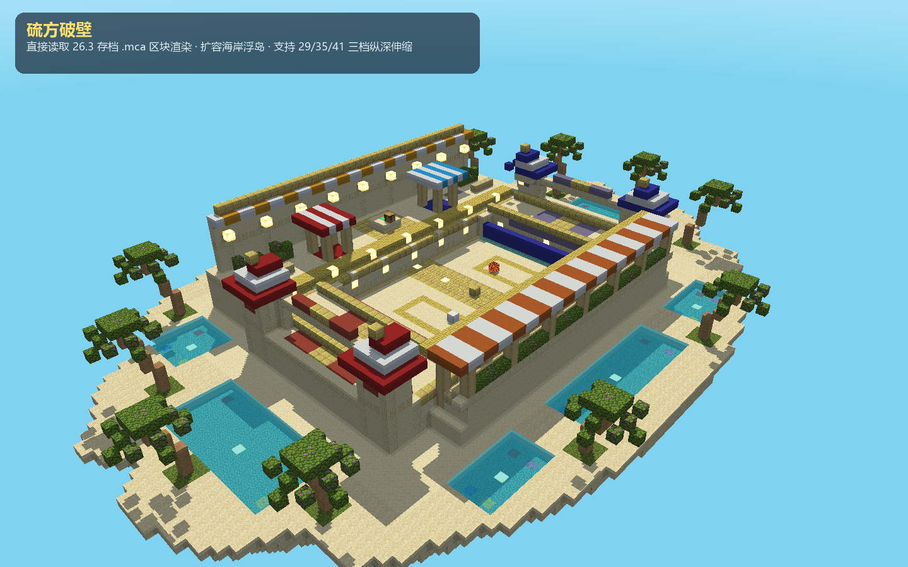
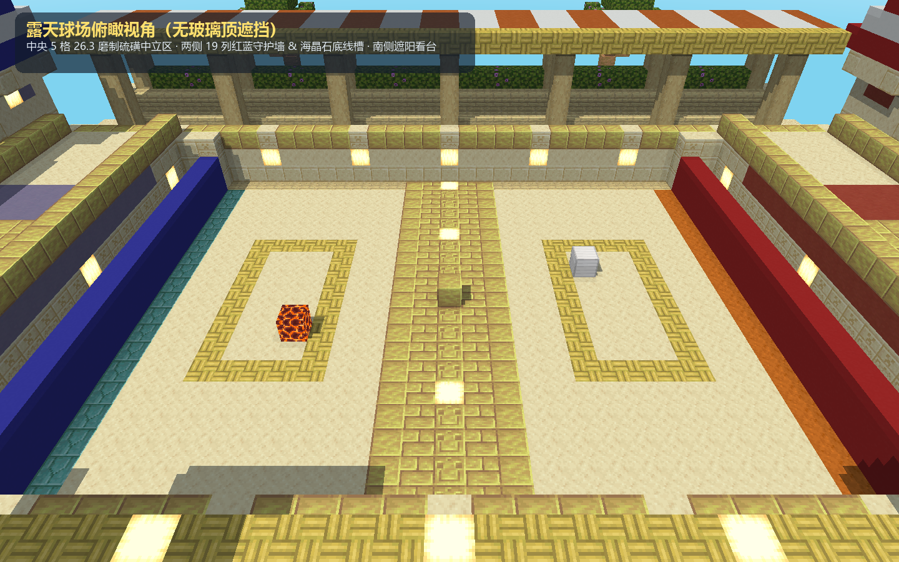
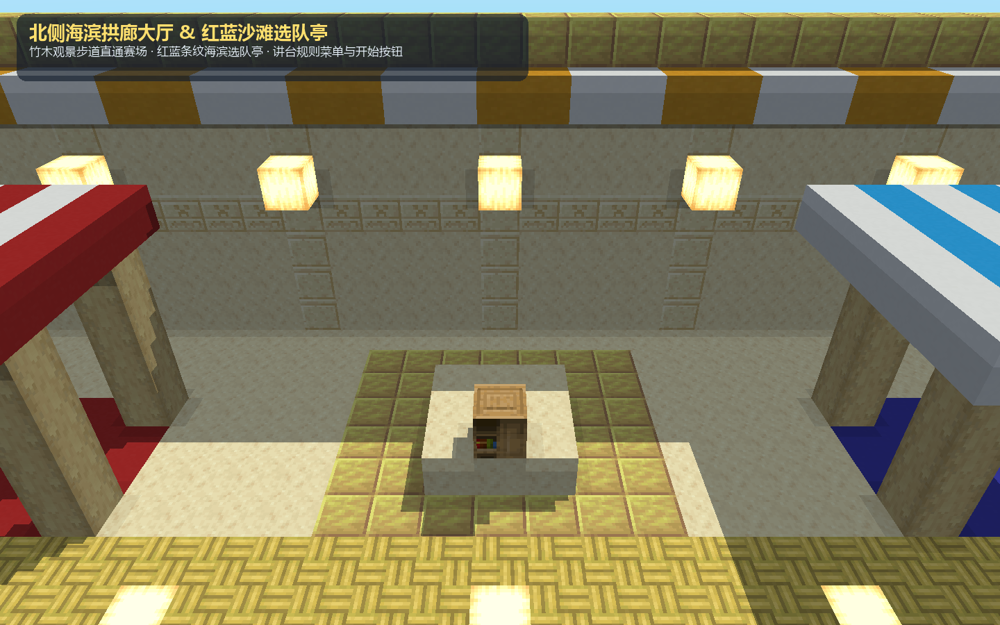

# 硫方破壁（Sulfur Breach）

基于 **Minecraft Java Edition 26.3**（`pack_format` `121.0`）打造的双队守墙 × 中立区争球 × 长矛物理弹射对抗小游戏。两队分居阳光海岸露天球场两侧，围绕 **26.3 原生硫方怪（Sulfur Cube）的内容物切换与高弹低摩擦碰撞物理**展开破城对抽。



| 露天破壁球场 | 北侧选队看台与中央高台 |
| :---: | :---: |
|  |  |

---

## 核心玩法

- **双墙对抗 + 三档纵深 + 5 格共享中立区**
  - 红蓝两队分守东西两侧各 **19 列可破坏守护墙**（默认每列 `2 HP`、整墙 `38 HP`，顶部双 Bossbar 实时同步），先击穿敌方整墙或限时结束时剩余墙体耐久更高的一方获胜。
  - 讲台支持三档场地纵深：**标准 `29×21`**（默认）、**加长 `35×21`**（两侧各深 `+3 格`）、**超长 `41×21`**（两侧各深 `+6 格`）。
  - 球场中央 `5 格` 宽硫磺带为**共享中立争球区**：双方均可踏入中立区抢攻或拦网，但不可越过中立区进入敌方专属半场。
- **无球权区分 · 四态硫方怪**
  - 球体不绑定阵营归属，撞上哪侧守护墙就扣哪侧耐久（救球打歪撞上自家墙同样破防）：
  - **空心态**：中立区自由晃荡，不会自行溜入半场；
  - **铁块芯（`iron_block`）**：左键击出，撞墙 **-1 HP**；未打穿时转为**凝灰岩卸力芯（`tuff`）**弹回，再次挥矛充能前不重复伤墙，无人看管超时后自动回中（可在讲台调整时长或关闭）；
  - **岩浆超载芯（`magma_block`）**：右键达速迎击或**跨中线连续往返对抽满 3 拍**自动升档，撞墙中心列 **-2 HP 贯通** + 左右邻列各 **-1 HP**；
  - **特殊突变球（可选）**：泥砖修补球（撞自家残墙回血，免疫超载转化）与紫水晶分裂球（撞墙额外派生子球）。
- **背板局部震波 & 5 阶双墙带伤前推**
  - 球穿过 `0 HP` 墙洞撞上后方背板时，仅对落点局部半径（常规 2 列 / 超载 3 列）内的存活残墙各扣 `1 HP`；若打入大缺口中心且半径内已无残墙，则 `0` 伤高弹回场继续对抽。
  - 比赛后半程启动 **5 阶双墙前推**，红蓝守护墙保留全部残血与破口同步向场心推进最多 `5 格`。
- **单矛纯粹操控**
  - 全员仅持 **1 把无突进破壁长矛**（左键稳挡控角，右键助跑迎击升档）+ **`+25% 移速` 疾风战靴**；零肉搏伤害，未出矛用身体硬挡运动球会被无伤震开。

---

## 部署与构建

地图进入世界即可直接在大厅选队开局，无需手动初始化。项目构建、客户端部署、打包与无头测试依赖 **[ICMCL/mcbeef](https://github.com/ICMCL/mcbeef)**：

```bash
mcbeef deploy    # 部署至本地客户端 saves/（加 --overwrite-map 同步覆盖地图区块）
mcbeef package   # 导出可独立分发的完整地图存档包 dist/*.zip
mcbeef build     # 重新生成世界区块与 previews/ 预览图
mcbeef test      # 运行 Minecraft 26.3 原版无头 GameTest
```

### 常用调试命令

- `/function sb:menu` — 打开比赛规则设置面板
- `/function sb:admin/force_start` — 单人或人数不足时强制开局调试
- `/function sb:admin/stop` — 强制结束当前对局并返回大厅
- `/function sb:install` — 手动重置大厅实体、计分板与赛场守墙

完整数值与机制设计详见 [DESIGN.md](./DESIGN.md)。
